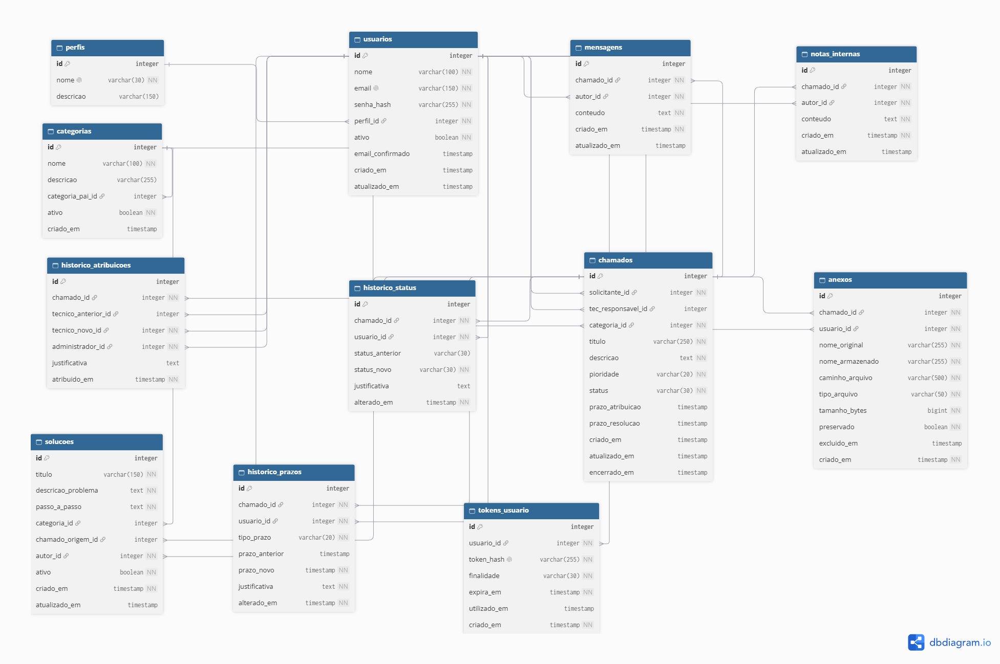

# 10. Banco de Dados

## 10.1. Tecnologia

O banco de dados do sistema será desenvolvido utilizando PostgreSQL, um sistema gerenciador de banco de dados relacional.

A modelagem está sendo realizada por meio do dbdiagram.io, utilizando DBML para representar as tabelas, seus atributos e relacionamentos.

A implementação física do banco será realizada posteriormente, em ambiente de desenvolvimento local.

## 10.2. Estrutura do banco

O modelo inicial contempla 12 tabelas:

| Tabela | Finalidade |
|---|---|
| perfis | Armazena os níveis de acesso do sistema. |
| usuarios | Armazena os dados das contas de usuários. |
| categorias | Organiza categorias e subcategorias dos chamados. |
| chamados | Armazena as solicitações de suporte. |
| mensagens | Registra a comunicação entre colaboradores e TI. |
| notas_internas | Armazena observações privadas da equipe de TI. |
| anexos | Armazena os metadados e caminhos dos arquivos enviados. |
| historico_atribuicoes | Registra atribuições e transferências de responsáveis. |
| historico_status | Registra as alterações de status dos chamados. |
| solucoes | Armazena soluções reutilizáveis para problemas recorrentes. |
| tokens_usuario | Gerencia tokens de confirmação de e-mail e recuperação de senha. |
| historico_prazos | Registra alterações manuais nos prazos dos chamados. |

### Figura 1 — Diagrama Entidade-Relacionamento do Sistema de Chamados de TI.

## 10.3. Relacionamentos e integridade

O banco utilizará chaves primárias (PK) e estrangeiras (FK) para estabelecer os relacionamentos entre as tabelas.

Também serão utilizadas restrições de integridade para garantir a consistência dos dados, incluindo:
- Campos obrigatórios.
- Valores únicos.
- Valores permitidos para status e prioridade.
- Relacionamentos entre usuários, chamados, categorias e históricos.

## 10.4. Segurança dos dados

As seguintes medidas serão consideradas na implementação:

- Senhas armazenadas por meio de hash seguro.
- Tokens armazenados por meio de hash.
- Controle de acesso conforme o perfil do usuário.
- Validação das operações realizadas no sistema.
- Proteção dos registros internos da equipe de TI.
- Preservação do histórico de operações importantes.

As permissões serão aplicadas principalmente na camada de aplicação (Flask), complementadas pelas restrições do banco de dados.

## 10.5. Armazenamento de anexos

Os arquivos enviados pelos colaboradores não serão armazenados diretamente no PostgreSQL.

O banco armazenará apenas os metadados dos anexos, incluindo:
- Nome original.
- Nome armazenado.
- Caminho do arquivo.
- Tipo.
- Tamanho.
- Estado de preservação.
- Data de exclusão lógica.

Os arquivos físicos serão armazenados separadamente, seguindo as regras de acesso e retenção definidas para o sistema.

## 10.6. Histórico e rastreabilidade

O sistema manterá registros específicos para acompanhar:
- Alterações de status.
- Atribuições e transferências de técnicos.
- Alterações de prazos.
- Mensagens e notas internas.

Esses registros permitirão consultar o histórico de atendimento de cada chamado.

## 10.7. Backup

O planejamento de backup contempla:
- Backup diário do PostgreSQL.
- Backup dos arquivos armazenados separadamente.
- Armazenamento protegido das cópias.
- Testes periódicos de restauração.

A política definitiva de retenção será estabelecida durante a implantação.

## 10.8. Situação atual

A modelagem lógica inicial foi estruturada no dbdiagram.io, contemplando 12 tabelas e seus relacionamentos.

**Próximas atividades:**
1. Revisar o modelo lógico durante a implementação.
2. Exportar o modelo para SQL compatível com PostgreSQL.
3. Criar o banco de dados no ambiente local.
4. Executar os scripts de criação das tabelas.
5. Validar os relacionamentos e as restrições.
6. Configurar a conexão entre Flask e PostgreSQL.

A implementação física do banco permanece pendente.