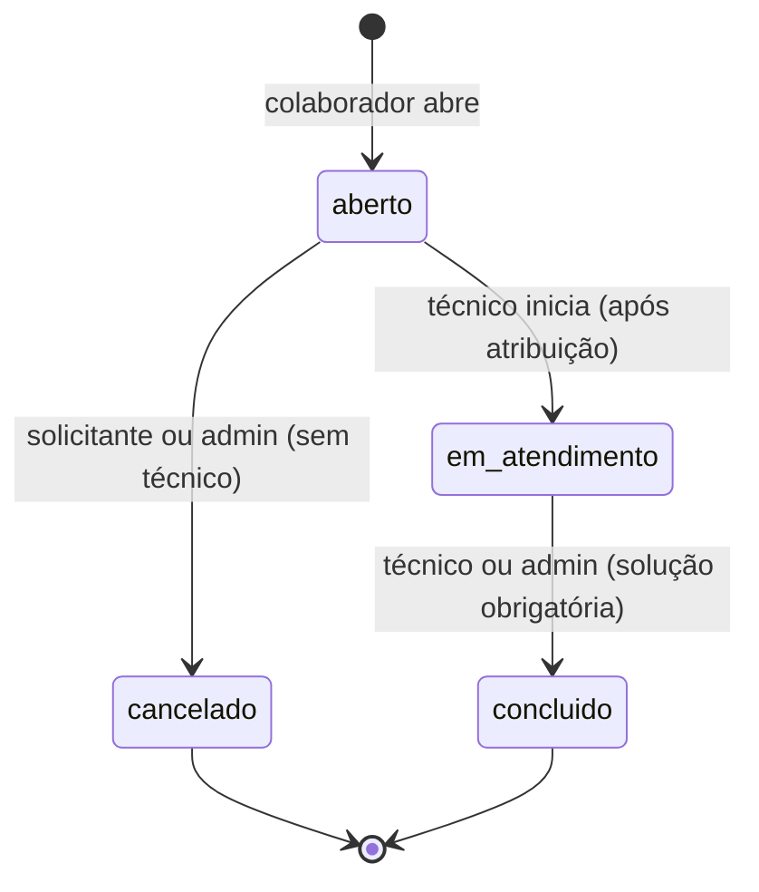
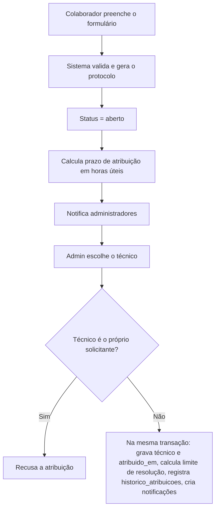
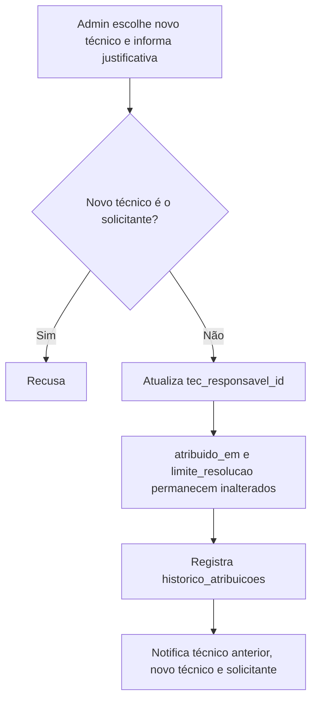
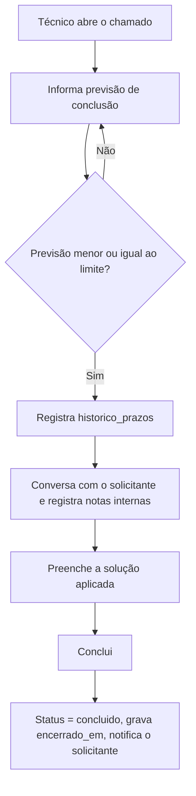
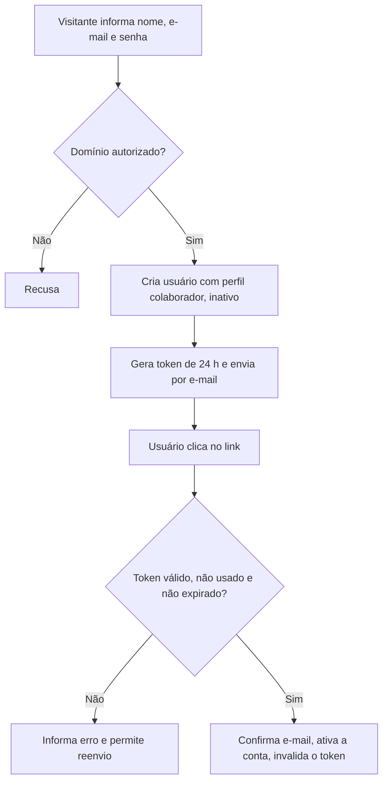
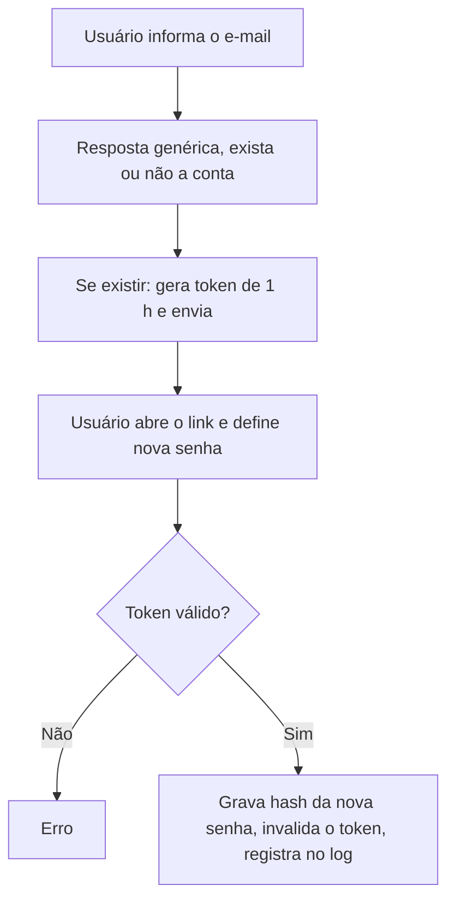
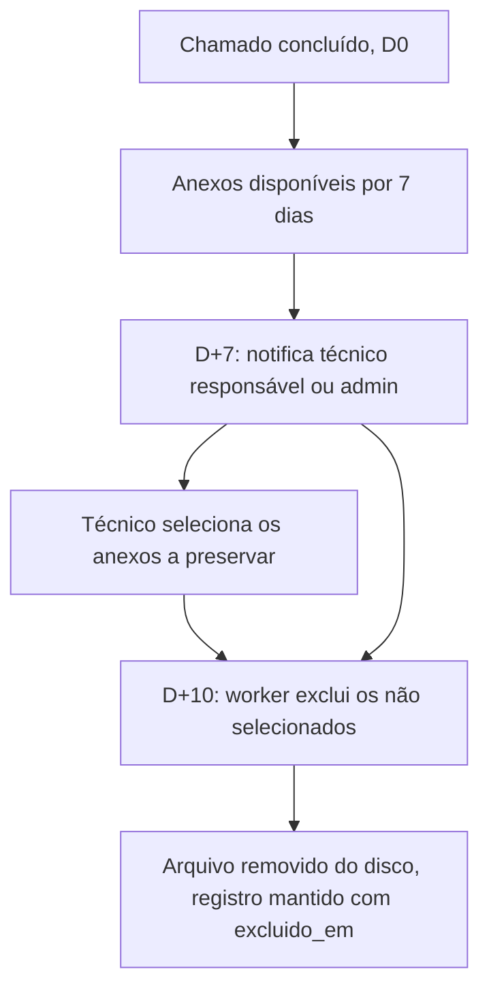
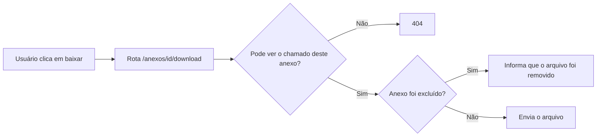

# Fluxos do Sistema

Os diagramas usam Mermaid e são exibidos automaticamente no GitHub.

## 1. Ciclo de vida do chamado

Chamados `cancelado` e `concluido` são finais: sem reabertura e sem novas mensagens.

## 2. Abertura e atribuição

## 3. Transferência

## 4. Atendimento e conclusão

## 5. Cadastro e confirmação de e-mail

## 6. Recuperação de senha

## 7. Retenção de anexos (Fase 2)

## 8. Entrega de anexo

